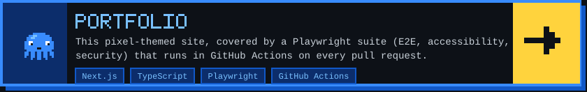
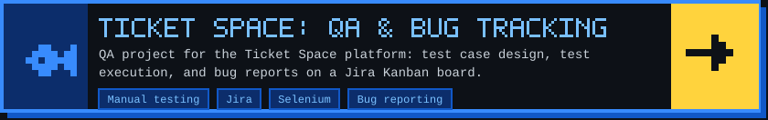
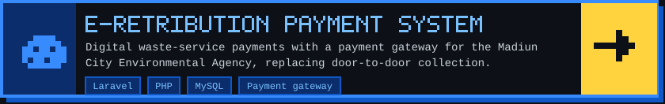

  

  
  
  

**Testing**

**Build**

**Ship**

<!-- Redrawn every day by .github/workflows/pacman.yml and published to the `output` branch. -->

  

  
  

  

Have a role, a project, or a question? Write to [wfzputra@gmail.com](mailto:wfzputra@gmail.com), message me on [LinkedIn](https://linkedin.com/in/wahyufzp), or use the form on [my portfolio](https://wahyufikri.vercel.app/en#contact).
